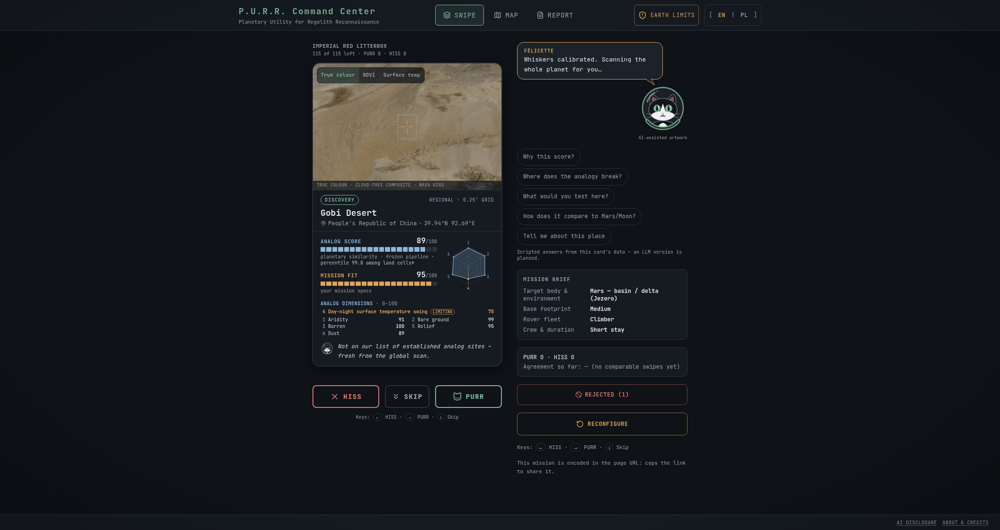
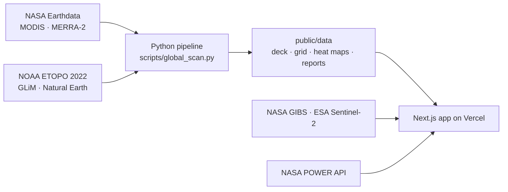

# P.U.R.R. Command Center

**Planetary Utility for Regolith Reconnaissance**: Earth analogs for Moon and Mars bases.

Félicette, the first cat in space (1963), scans every patch of land on Earth and tells you where to rehearse a Moon or Mars base. She also tells you where the analogy breaks.

**[Open the live app →](https://purr-command-center.vercel.app)** · NASA Space Apps Challenge 2026 · Team **Project Félicette** (Sebastian Kraska)

Challenge: *Identify Earth Locations that Analog the Permanent Moon Base Locations and Mars*


<sub>Mascot artwork is AI-assisted.</sub>

---

## What it does

1. **Plan a base.** Pick a target (Shackleton rim, Mare Tranquillitatis lava-tube pit, Jezero crater, Arcadia Planitia), base footprint, rover fleet and crew.
2. **Swipe Earth analogs.** Every card has real satellite imagery (NASA GIBS, ESA Sentinel-2), two separate scores and a radar of every dimension:
   - the **Analog Score** is planetary similarity, from a frozen method;
   - the **Mission Fit** is engineering fit for *your* mission and never changes the Analog Score.
3. **Explore the planet.** Click any point on Earth to see all four targets side by side, a plain-language reason for low scores, and live NASA POWER climate.
4. **Read the report.** It covers your picks, the validation, Earth's limits and every source.

Each card explains where the analogy holds, where it breaks, what global data cannot see, and what to test there.

## Does it work?

All scoring rules were committed to git **before** any validation was run ([`4cfc24a`](docs/METHOD_LOG.md), v2 `de66a69`).

Median percentile among all scored land cells:

| Target | Known analogs | Traps |
|---|---|---|
| Moon · Shackleton rim | **99.6** | 18.2 |
| Moon · lava-tube pit | **79.5** | 17.8 |
| Mars · Jezero | **93.3** | 11.0 |
| Mars · Arcadia Planitia | **75.0** | 21.0 |

- **Known analogs:** Atacama, McMurdo Dry Valleys, Devon Island, Death Valley, Craters of the Moon, among others.
- **Traps:** the Amazon and Ostrzyca (PL).
- **Robustness:** across 200 Monte Carlo runs (weights ±25 %, thresholds ±15 %), benchmarks stay above traps for all four targets.

**New candidates:**
- Haruj and Harrat lava fields → lunar lava-tube pit
- Dasht-e Lut and the Taklamakan → Jezero
- Melville and Prince Patrick Islands → Arcadia

Hammaguir, Félicette's own 1963 launch pad in the Algerian Sahara, scores 78/100 for Jezero (≈98th percentile). The method knew nothing about the site.

Full tables are in [`docs/VALIDATION_REPORT.md`](docs/VALIDATION_REPORT.md).

## How it works



**Pipeline (offline, once):**
- Regrids seven global datasets for 2023 onto a 0.25° grid (341,212 land cells).
- Scores every cell for the four targets.
- Validates against known analogs and traps, runs a sensitivity analysis, extracts candidate regions, and exports static files.

**Scoring:**
- Each dimension is scored 0–1 by *how far Earth gets toward the planetary condition*, not by distance to Mars or the Moon, which no Earth site comes close to.
- Dimensions are combined with a **weighted geometric mean**, so one failing dimension (e.g. a forest) sinks the analog.
- Rules and rationales live in [`scripts/config/targets.json`](scripts/config/targets.json).

**App:**
- A static Next.js site. It reads the published files and calls NASA GIBS, NASA POWER and Sentinel-2 tiles live.
- No backend, no database.

## Data

| Source | Used for |
|---|---|
| NASA MODIS MOD13C2, MOD11C3, MCD12C1 (v061) | vegetation (NDVI), surface temperature, land cover |
| NASA MERRA-2 M2TMNXFLX, M2TMNXAER | precipitation, dust |
| NOAA ETOPO 2022 | relief, slope, trafficable terrain |
| GLiM (Hartmann & Moosdorf 2012) | basalt fraction |
| NASA GIBS, NASA POWER | live imagery and climate cross-check |
| ESA Copernicus Sentinel-2 cloudless 2025 (EOX) | 10 m site imagery |
| LRO Diviner/LOLA, Mars 2020 MEDA, MRO SHARAD (via peer-reviewed papers) | Moon and Mars reference values |

DOIs and versions are listed in [`public/data/manifest.json`](public/data/manifest.json) and [`docs/PLANETARY_REFERENCE.md`](docs/PLANETARY_REFERENCE.md).

## Limits

- Earth cannot reproduce lunar or Martian gravity, vacuum or radiation.
- Global data cannot see mineralogy, caves or buried ice.
- Cells are ~28 km; data covers one year (2023).
- The lava-tube target has the thinnest separation between analogs and traps.
- Known post-hoc limitations are recorded, not silently fixed: see [`docs/METHOD_LOG.md`](docs/METHOD_LOG.md).

## Run it locally

```bash
npm install
npm run dev        # http://localhost:3000
npm test           # unit tests (Vitest)
```

To regenerate the data (optional):
- needs a free NASA Earthdata account (`EARTHDATA_USERNAME` / `EARTHDATA_PASSWORD` in `.env.local`);
- downloads ~7.7 GB.

```bash
python3 -m venv scripts/.venv && source scripts/.venv/bin/activate
pip install -r scripts/requirements.txt
python scripts/global_scan.py all --years 2023
python scripts/global_scan.py export --publish
```

## More

- [`docs/METHOD_LOG.md`](docs/METHOD_LOG.md): pre-registration and every method change
- [`docs/MISSION_FIT.md`](docs/MISSION_FIT.md): mission-fit rules and Félicette's verdict thresholds
- [`docs/AI_DISCLOSURE.md`](docs/AI_DISCLOSURE.md): how AI tools were used

## Credits & disclosure

This is an independent hackathon project. It is not affiliated with or endorsed by NASA or ESA.

Sentinel-2 cloudless 2025 by EOX IT Services GmbH (contains modified Copernicus Sentinel data 2025), CC BY-NC-SA 4.0.

The concept and design decisions are the author's. Code was written with AI assistance (Anthropic Claude Code); research, review and planning were assisted by Claude and Google Gemini; the Félicette mascot artwork is AI-assisted. All data values come from cited datasets and publications, not from AI. Details are in [`docs/AI_DISCLOSURE.md`](docs/AI_DISCLOSURE.md).
